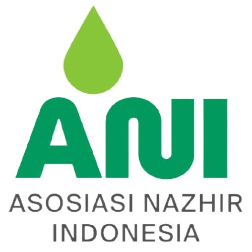
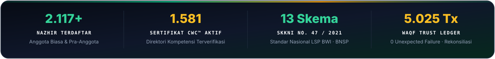

  
  <h1>Asosiasi Nazhir Indonesia (ANI)</h1>
  
<strong>Organisasi Profesi Nazhir Wakaf Nasional · Standarisasi Kompetensi, Tata Kelola & Akselerasi Ekosistem Wakaf Produktif</strong>

  <picture>
    <source media="(prefers-color-scheme: dark)" srcset="https://readme-typing-svg.demolab.com?font=Fira+Code&weight=600&size=19&pause=1200&color=10B981&center=true&vCenter=true&width=780&lines=Wadah+Resmi+Kolaborasi+%26+Standarisasi+Nazhir+Wakaf+Indonesia;Paradigma+Nazhir+BERDAYA+%C2%B7+Strategi+Akselerasi+5C;Indonesian+Nazhir+Academy+(INA)+%26+Direktori+Gelar+CWC%E2%84%A2;Smart+Nazhir+Ecosystem+2030+%C2%B7+Dashboard%2C+AI+%26+Waqf+Trust+Ledger;Kepatuhan+UU+41%2F2004+%C2%B7+SKKNI+47%2F2021+%C2%B7+PSAK+112+%26+PSAK+412" />
    <source media="(prefers-color-scheme: light)" srcset="https://readme-typing-svg.demolab.com?font=Fira+Code&weight=600&size=19&pause=1200&color=01995E&center=true&vCenter=true&width=780&lines=Wadah+Resmi+Kolaborasi+%26+Standarisasi+Nazhir+Wakaf+Indonesia;Paradigma+Nazhir+BERDAYA+%C2%B7+Strategi+Akselerasi+5C;Indonesian+Nazhir+Academy+(INA)+%26+Direktori+Gelar+CWC%E2%84%A2;Smart+Nazhir+Ecosystem+2030+%C2%B7+Dashboard%2C+AI+%26+Waqf+Trust+Ledger;Kepatuhan+UU+41%2F2004+%C2%B7+SKKNI+47%2F2021+%C2%B7+PSAK+112+%26+PSAK+412" />
    
  </picture>

  

    
    
    
    
    
    
  

<picture>
  <source media="(prefers-color-scheme: dark)" srcset="https://raw.githubusercontent.com/asosiasinazhir/.github/main/assets/banner-dark.svg" />
  <source media="(prefers-color-scheme: light)" srcset="https://raw.githubusercontent.com/asosiasinazhir/.github/main/assets/banner-light.svg" />
  
</picture>

<picture>
  <source media="(prefers-color-scheme: dark)" srcset="https://raw.githubusercontent.com/asosiasinazhir/.github/main/assets/divider-dark.svg" />
  <source media="(prefers-color-scheme: light)" srcset="https://raw.githubusercontent.com/asosiasinazhir/.github/main/assets/divider-light.svg" />
  
</picture>

### 🏛️ Tentang ANI & 4 Pilar Ekosistem Nasional

Didirikan pada **Oktober 2022** di Jakarta sebagai organisasi profesi nazhir wakaf nasional pertama yang berbadan hukum Perkumpulan ber-SK Kemenkumham, **Asosiasi Nazhir Indonesia (ANI)** menggerakkan masa bakti kepengurusan pusat **2025–2030** (hasil Munas I) berlandaskan falsafah **Nazhir BERDAYA** (*Bersatu, Berkolaborasi, Bersinergi · Daya Juang, Daya Saing, Daya Cipta, Daya Kelola*) serta strategi akselerasi **5C** (*Campaign, Create, Convert, Competent, Comply*).

<table>
  <tr>
    <td width="50%" valign="top">

#### 🎓 Indonesian Nazhir Academy (INA) & Gelar CWC™
Sekolah wakaf nasional dan pusat pelatihan vokasi berbasis `SKKNI No. 47 Tahun 2021` (13 skema sertifikasi LSP BWI / BNSP), terintegrasi dengan [Direktori Gelar CWC™](https://www.ani.or.id/direktori-cwc/) terverifikasi dan mesin validasi dokumen ber-QR Code di [`ani.or.id/verifikasi`](https://www.ani.or.id/verifikasi/).

</td>
    <td width="50%" valign="top">

#### 📊 Smart Nazhir Ecosystem 2030
Masterplan Divisi Inovasi & Digitalisasi (2026–2030) meliputi **Dashboard Wakaf Nasional SaaS** ([`nazhir.id`](https://nazhir.id)), Platform Fundraising Wakaf Bersama terverifikasi, kampanye literasi digital Gen-Z & Milenial, serta Inkubator *Waqf-Tech*.

</td>
  </tr>
  <tr>
    <td width="50%" valign="top">

#### ⛓️ Waqf Trust Ledger & Standar ERP Syariah
Infrastruktur rekonsiliasi transaksi wakaf uang lintas LKS-PWU, Payment Gateway, Nazhir & Regulator dengan kepatuhan `PSAK 112/412`, prinsip **pokok wakaf utuh 100%** (mitigasi selisih MDR fee & *unidentified deposit*), serta *sub-ledger hash batching*.

</td>
    <td width="50%" valign="top">

#### 🤝 Sinergi Regulator & Diplomasi Global
Kemitraan strategis nasional bersama **Kemenag RI**, **BWI**, **Bank Indonesia**, **KNEKS**, dan **FORNAS MAZAWA** (*Indonesia Melek Wakaf*), serta diplomasi global bersama **WZWF**, **IIIW**, **Waqaf An-Nur**, dan **MAIPs**.

</td>
  </tr>
</table>

<picture>
  <source media="(prefers-color-scheme: dark)" srcset="https://raw.githubusercontent.com/asosiasinazhir/.github/main/assets/divider-dark.svg" />
  <source media="(prefers-color-scheme: light)" srcset="https://raw.githubusercontent.com/asosiasinazhir/.github/main/assets/divider-light.svg" />
  
</picture>

### 🚀 Ekosistem Digital & Repositori Open-Source

<table>
  <tr>
    <td width="50%" valign="top">

#### 📊 [`nazhir.id`](https://github.com/asosiasinazhir/nazhir.id) · 
**Dashboard Wakaf Nasional ANI** untuk konsolidasi data aset, laporan arus kas, dan pengukuran dampak sosial (*Social Return on Investment* / SROI) seluruh nazhir anggota menuju Smart Nazhir Ecosystem 2030.

</td>
    <td width="50%" valign="top">

#### ⛓️ [`waqf-chain`](https://github.com/asosiasinazhir/waqf-chain) · 
**Buku besar (*immutable ledger*) & dashboard transparansi publik** bagi lembaga nazhir untuk menyajikan pelaporan wakaf yang *tamper-proof*, terverifikasi, dan siap diaudit publik maupun regulator.

</td>
  </tr>
  <tr>
    <td width="50%" valign="top">

#### 🏛️ [`waqf-odoo-modules`](https://github.com/asosiasinazhir/waqf-odoo-modules) & [`waqf-odoo-docker`](https://github.com/asosiasinazhir/waqf-odoo-docker)
**Suite ERP Nazhir Wakaf berbasis Odoo 18/19** dengan dukungan akuntansi syariah `PSAK 412/112`, tata kelola `AIW/APAIW`, skema kompetensi `LSP BWI`, dan penyaluran manfaat *mauquf 'alaih* — kolaborasi bersama Amal Produktif & FWP.

</td>
    <td width="50%" valign="top">

#### 🤖 [`waqf-agentic-workflow`](https://github.com/asosiasinazhir/waqf-agentic-workflow) · 
**Orkestrasi multi-agen AI terdistribusi** yang dipetakan langsung ke 10 skema sertifikasi kompetensi nazhir LSP BWI (`SS.001`–`SS.010`) untuk membantu otomasi operasional lembaga nazhir.

</td>
  </tr>
  <tr>
    <td width="50%" valign="top">

#### 📣 [`nazhir-reach`](https://github.com/asosiasinazhir/nazhir-reach) · 
**Mesin distribusi kampanye patuh syariah**, *wakif retention flywheel*, serta atribusi dampak keuangan `PSAK 412/109` yang dirancang khusus untuk Nazhir Wakaf dan Lembaga Amil Zakat (LAZ).

</td>
    <td width="50%" valign="top">

#### 🛡️ Portal e-Sekretariat & Keanggotaan ([`ani.or.id`](https://www.ani.or.id))
**Sistem keanggotaan nasional berjenjang** (Anggota Biasa & Pra-Anggota), proteksi PII/NIK dengan kriptografi `libsodium` + HMAC-SHA256 *Blind Index*, e-Office persuratan DPP, dan validasi sertifikat CWC™ berbasis QR Code.

</td>
  </tr>
</table>

<picture>
  <source media="(prefers-color-scheme: dark)" srcset="https://raw.githubusercontent.com/asosiasinazhir/.github/main/assets/divider-dark.svg" />
  <source media="(prefers-color-scheme: light)" srcset="https://raw.githubusercontent.com/asosiasinazhir/.github/main/assets/divider-light.svg" />
  
</picture>

### 🛠️ Arsitektur Teknologi & Standar Kepatuhan

  <picture>
    <source media="(prefers-color-scheme: dark)" srcset="https://skillicons.dev/icons?i=ts%2Cpython%2Cphp%2Csolidity%2Creact%2Cnextjs%2Castro%2Ctailwind%2Cnodejs%2Cpostgres%2Cmysql%2Credis%2Cdocker%2Ccloudflare%2Cgithubactions&perline=15&theme=dark" />
    <source media="(prefers-color-scheme: light)" srcset="https://skillicons.dev/icons?i=ts%2Cpython%2Cphp%2Csolidity%2Creact%2Cnextjs%2Castro%2Ctailwind%2Cnodejs%2Cpostgres%2Cmysql%2Credis%2Cdocker%2Ccloudflare%2Cgithubactions&perline=15&theme=light" />
    
  </picture>

 

| Pilar Arsitektur | Standar, Regulasi & Teknologi |
| :--- | :--- |
| **📜 Regulasi & Standar Wakaf** | `UU No. 41/2004` · `PP No. 42/2006` · `SKKNI No. 47/2021` · `PSAK 112 & PSAK 412` · `AAOIFI SS 60` · `13 Skema LSP BWI / BNSP` |
| **⚙️ ERP & Core Systems** | `Odoo 18 & 19` (OCA Standard) · `WordPress + ani-sekretariat` · `Python` · `PHP 8.3` · `MariaDB 11.8` · `PostgreSQL` |
| **🌐 Web, Edge & Portal** | `TypeScript` · `Astro` · `Next.js` · `React` · `Hono` · `Tailwind CSS` · `Cloudflare Workers & Pages` |
| **🔐 Keamanan & Kriptografi** | `Libsodium (crypto_secretbox)` · `HMAC-SHA256 Blind Index` · `Protected Private File Storage` · `QR Verification` |
| **⛓️ Ledger & Agentic AI** | `Permissioned Trust Ledger` · `Solidity / Ethereum Sepolia` · `Sub-Ledger Hash Batching` · `Multi-Agent Workflows` |

<picture>
  <source media="(prefers-color-scheme: dark)" srcset="https://raw.githubusercontent.com/asosiasinazhir/.github/main/assets/divider-dark.svg" />
  <source media="(prefers-color-scheme: light)" srcset="https://raw.githubusercontent.com/asosiasinazhir/.github/main/assets/divider-light.svg" />
  
</picture>

### 📚 Referensi Kelembagaan & Standar Nasional

<b>🏛️ Struktur Kepengurusan Pusat DPP ANI (Masa Bakti 2025–2030 · SK 01/ANI1/X/2025)</b>

| Unsur Kepengurusan | Pimpinan / Penanggung Jawab | Fokus Mandat |
| :--- | :--- | :--- |
| **Dewan Pengawas** | **Dr. Nur S Buchori, S.E., S.Pd., M.Si., CWC** (Ketua) · H. Abdul Rasyid Suharto, M.Ed., CWC · Ir. Iwan Agustiawan Fuad, M.Si., CWC | Pengawasan tata kelola, kepatuhan etik, & arah strategis organisasi |
| **Pengurus Harian** | **Imam Nur Azis, MA, CWC** (Presiden) · Ahmad Nizar, S.E., M.Si., CWC (Wapres) · Eko Priyanto, S.E., CWC (Sekjen) · H. Asnan Purba, Lc., M.Pd.I., CWC (Wasekjen) · Deddy Fenalosa, M.M., CWC (Bendum) · Drs. Bachfuandi Yulwin, M.M., CWC (Wabendum) | Kepemimpinan eksekutif nasional, e-Sekretariat DPP, & tata kelola keuangan |
| **Divisi Inovasi & Digitalisasi** | **Ridlo Abelian, S.T., M.Si., CTA, CWC** (Ketua Divisi) | *Smart Nazhir Ecosystem 2030*, *Waqf Trust Ledger*, Dashboard Nasional & e-Sekretariat |
| **Divisi Kelembagaan & SDM Nazhir** | **Mohamad Arifin Purwakananta, M.I.Kom., CWC, CFRM** (Ketua Divisi) | Tata kelola kelembagaan, kode etik profesi, SDM nazhir, & integrasi INA |
| **Divisi Pengelolaan & Pengembangan Wakaf** | **dr. Ahmad Tawakkal, MBA, CWC** (Ketua Divisi) | Portofolio wakaf produktif, inkubasi BUMW, optimalisasi aset *idle*, & *mauquf 'alaih* |
| **Divisi Regulasi & Advokasi** | **Prof. Dr. Helza Nova Lita, S.H., M.H., CWC** (Ketua Divisi) | Advokasi amandemen UU No. 41/2004, sertifikasi tanah AIW/APAIW, & perlindungan aset |
| **Divisi Riset & Ekonomi Wakaf** | **Prof. Dr. Achmad Firdaus, CWC** (Ketua Divisi) | Riset makroekonomi wakaf, insentif fiskal, instrumen CWLS & CWLD |
| **Divisi Kerjasama & Jaringan** | **R. Kukun Agung Sulistiyo, S.Sos., M.Si., CWC** (Ketua Divisi) | Sinergi multipihak (Kemenag, BWI, BI, KNEKS, FORNAS MAZAWA) & diplomasi global |
| **Badan Khusus & Daerah** | **Indonesian Nazhir Academy (INA)** & Pengurus Wilayah (percontohan **PW Sumatera Utara**) | Pendidikan vokasi, persiapan uji kompetensi LSP BWI, & ekspansi PW se-Indonesia |

<b>🧭 Roadmap Smart Nazhir Ecosystem (2026–2030) & Solusi 4 Friksi Operasional Wakaf Uang</b>

*Empat solusi terstandar ANI untuk friksi operasional lapangan pengelolaan wakaf uang nasional:*

| Titik Friksi Lapangan | Risiko Fiqh & Hukum | Solusi Terstandar ANI |
| :--- | :--- | :--- |
| **1. Unidentified Deposit** | Dana tertahan di rekening LKS-PWU; AIW/SWU tidak dapat diterbitkan | Kewajiban *metadata* ikrar wakif di smart contract sebelum mutasi diakui sebagai wakaf sah |
| **2. Selisih Potongan Biaya (MDR Fee)** | Pokok wakaf uang terpotong biaya payment gateway (melanggar keutuhan pokok wakaf) | Protokol penjaminan talangan subsidi otomatis dari infak operasional agar **pokok wakaf tetap 100%** |
| **3. Agregasi Harian (Batch Settlement)** | Ratusan transaksi mikro CRM tergabung dalam 1 baris mutasi bank | Mekanisme *sub-ledger hash batching* untuk rekonsiliasi otomatis lintas lembaga |
| **4. Salah Rekening Akad** | Percampuran akun wakaf abadi dengan infak/sedekah pada audit `PSAK 112` | Standarisasi penomoran rekening terpisah & verifikasi akad otomatis saat transaksi digital |

*Tonggak perjalanan 5 tahun transformasi digital nazhir nasional:*

| Tahun | Fase | Target Utama |
| :---: | :--- | :--- |
| **2026** | **Fondasi & Infrastruktur** | Cetak Biru Arsitektur Digital · Rilis Dashboard Beta (`nazhir.id`) · Peluncuran Indonesian Nazhir Academy (INA) |
| **2027** | **Edukasi & Uji Coba** | Soft Launching Platform Fundraising Bersama · Sertifikasi Digital Nazhir Batch 1 · Roadshow Literasi 5 Kota |
| **2028** | **Integrasi & Skalabilitas** | Integrasi API Host-to-Host dengan BWI / Kemenag · Cohort Inkubasi *Waqf-Tech* · 40% Adopsi Dashboard |
| **2029** | **Optimasi & Ekspansi** | Modul Prediksi AI Tren Wakaf · Ekspansi Pasar Diaspora Global · Audit Keamanan Informasi ISO 27001 |
| **2030** | **Kematangan Ekosistem** | Ekosistem Mandiri (*Self-Sustaining*) · **85% Adopsi Anggota** · Whitepaper Transformasi Digital Nazhir |

<picture>
  <source media="(prefers-color-scheme: dark)" srcset="https://raw.githubusercontent.com/asosiasinazhir/.github/main/assets/divider-dark.svg" />
  <source media="(prefers-color-scheme: light)" srcset="https://raw.githubusercontent.com/asosiasinazhir/.github/main/assets/divider-light.svg" />
  
</picture>

### 🏢 Sekretariat Pusat & Kanal Resmi

- **Alamat Sekretariat**: Gedung Menara 165 Lantai 4, Jl. TB Simatupang Kav. 1, Kel. Cilandak Timur, Kec. Pasar Minggu, Jakarta Selatan, DKI Jakarta 12560
- **Telepon Kantor**: `(021) 5081 2002` · **WhatsApp Resmi**: `0811-1773-334`
- **Portal Resmi**: [www.ani.or.id](https://www.ani.or.id) · **Email**: [`info@ani.or.id`](mailto:info@ani.or.id) / [`sekretariat@ani.or.id`](mailto:sekretariat@ani.or.id)
- **Media Sosial**: Instagram [`@asosiasinazhir`](https://instagram.com/asosiasinazhir)

 

  <picture>
    <source media="(prefers-color-scheme: dark)" srcset="https://raw.githubusercontent.com/asosiasinazhir/.github/main/assets/footer-dark.svg" />
    <source media="(prefers-color-scheme: light)" srcset="https://raw.githubusercontent.com/asosiasinazhir/.github/main/assets/footer-light.svg" />
    
  </picture>

